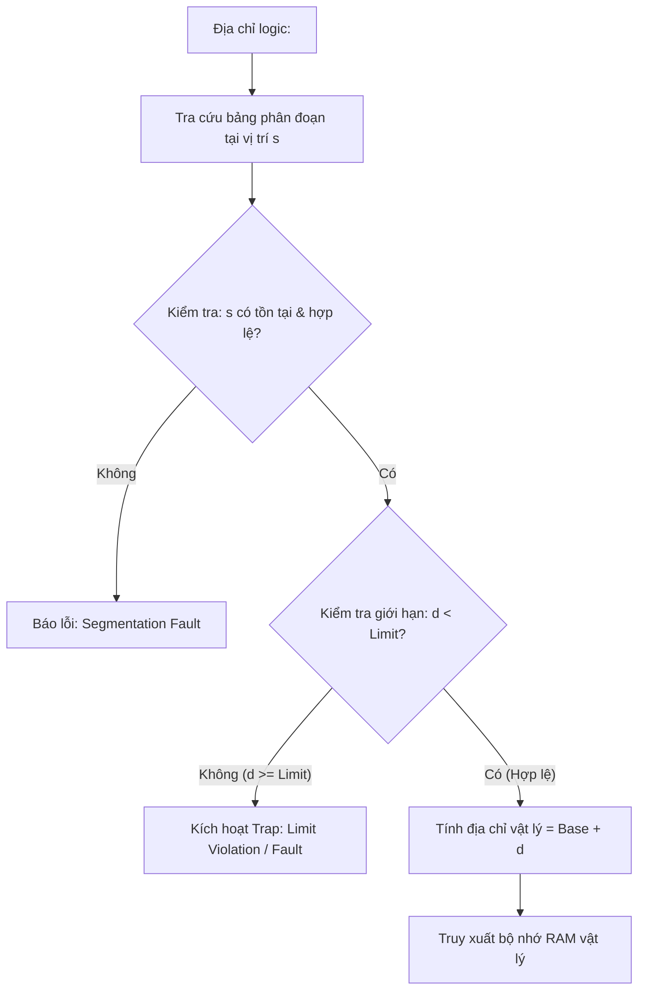

# Tài Liệu Lý Thuyết: Phân Đoạn Bộ Nhớ & MMU (Segmentation & MMU)

> **Phụ trách:** Người 1  
> **Môn học:** Hệ Điều Hành (Operating Systems)

---

## 1. Giới Thiệu Về Kỹ Thuật Phân Đoạn (Segmentation)

Trong các hệ điều hành hiện đại, **Phân đoạn (Segmentation)** là một kỹ thuật quản lý bộ nhớ phi liên tục nhằm hỗ trợ góc nhìn trực quan của lập trình viên về không gian địa chỉ bộ nhớ.

Thay vì coi bộ nhớ là một mảng byte tuyến tính liên tục (Linear array), một chương trình được chia thành các **phân đoạn logic (segments)** có độ dài biến thiên, tương ứng với các thành phần thực tế của chương trình:
- Phân đoạn mã lệnh (**Code/Text Segment**)
- Phân đoạn dữ liệu toàn cục (**Data Segment**)
- Phân đoạn vùng nhớ động (**Heap Segment**)
- Phân đoạn ngăn xếp (**Stack Segment**)
- Các thư viện liên kết hoặc hàm con (**Subroutines/Libraries**)

---

## 2. Cấu Trúc Địa Chỉ Logic (Logical Address)

Một địa chỉ logic trong cơ chế phân đoạn gồm 2 phần:
$$\text{Logical Address} = \langle s, d \rangle$$

Trong đó:
- **$s$ (Segment Number / ID):** Chỉ số xác định phân đoạn trong Bảng phân đoạn (*Segment Table*).
- **$d$ (Offset / Displacement):** Độ lệch hay vị trí tương đối tính từ đầu phân đoạn đó.

---

## 3. Bảng Phân Đoạn (Segment Table)

Mỗi tiến trình sở hữu một Bảng phân đoạn riêng. Mỗi mục (*entry*) trong bảng gồm 2 trường dữ liệu cốt lõi:
1. **Base (Cơ sở):** Địa chỉ vật lý bắt đầu của phân đoạn trong RAM.
2. **Limit (Giới hạn / Độ dài):** Chiều dài tối đa (số byte) của phân đoạn.

Ngoài ra, bảng có thể mở rộng thêm các cờ:
- **Valid/Invalid bit:** Phân đoạn có đang nằm trong bộ nhớ vật lý hay không.
- **Protection bits:** Quyền truy cập (Read, Write, Execute).

---

## 4. Cơ Chế Dịch Địa Chỉ Của MMU (Memory Management Unit)

Phần cứng MMU chịu trách nhiệm chuyển đổi địa chỉ logic $\langle s, d \rangle$ thành địa chỉ vật lý theo quy trình sau:

### Các bước chi tiết:
1. MMU nhận địa chỉ logic $\langle s, d \rangle$.
2. Sử dụng $s$ làm chỉ số truy cập vào Bảng phân đoạn để lấy cặp giá trị $\langle \text{Base}, \text{Limit} \rangle$.
3. **Kiểm tra an toàn (Boundary Check):**
   - Nếu $d \ge \text{Limit}$: MMU kích hoạt ngắt phần cứng (Trap to OS) báo lỗi vi phạm giới hạn (**Addressing Error / Limit Violation**), chương trình bị dừng.
4. **Tính địa chỉ vật lý:**
   $$\text{Physical Address} = \text{Base} + d$$
5. Đọc/ghi dữ liệu tại địa chỉ vật lý này trên RAM.

---

## 5. Ví Dụ Minh Họa

Giả sử Bảng phân đoạn có các mục sau:

| Segment ID | Base | Limit | Mô tả |
|:----------:|:----:|:-----:|:------|
| **0** | 219 | 600 | Subroutine |
| **1** | 2300 | 14 | Sqrt module |
| **2** | 90 | 100 | Main program |
| **3** | 1327 | 580 | Stack |
| **4** | 1952 | 96 | Symbol table |

### Tình huống 1: Dịch hợp lệ
- Địa chỉ logic: $\langle s = 0, d = 100 \rangle$
- Kiểm tra: $d = 100 < \text{Limit} = 600$ (Thỏa mãn).
- Địa chỉ vật lý: $\text{Base} + d = 219 + 100 = \mathbf{319}$.

### Tình huống 2: Vi phạm giới hạn (Limit Trap)
- Địa chỉ logic: $\langle s = 1, d = 20 \rangle$
- Kiểm tra: $d = 20 \ge \text{Limit} = 14$ (Vi phạm!).
- **Kết quả:** Trap báo lỗi vi phạm phân đoạn.

---

## 6. So Sánh Phân Đoạn (Segmentation) và Phân Trang (Paging)

| Tiêu chí | Phân đoạn (Segmentation) | Phân trang (Paging) |
|:---|:---|:---|
| **Kích thước khối** | Kích thước thay đổi động (Variable size) | Kích thước cố định (Fixed size: 4KB, 2MB,...) |
| **Góc nhìn** | Phù hợp góc nhìn logic của lập trình viên | Thuần túy phần cứng, trong suốt với lập trình viên |
| **Hiện tượng phân mảnh** | Phân mảnh ngoài (**External Fragmentation**) | Phân mảnh trong (**Internal Fragmentation**) |
| **Bảo vệ & Chia sẻ** | Dễ dàng áp dụng quyền truy cập theo từng hàm/module | Phức tạp hơn vì ranh giới trang không khớp với logic mã nguồn |
